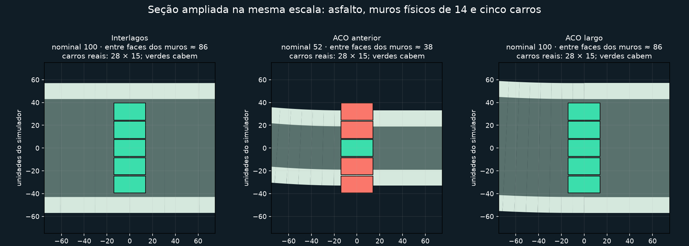
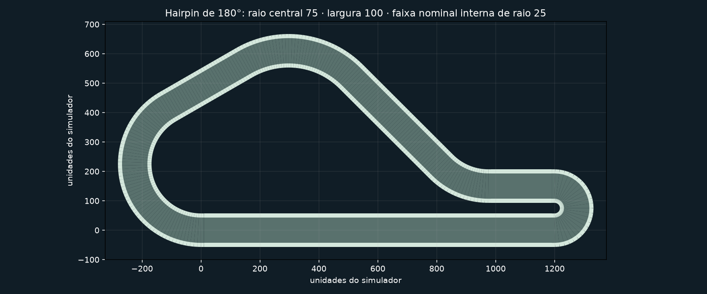
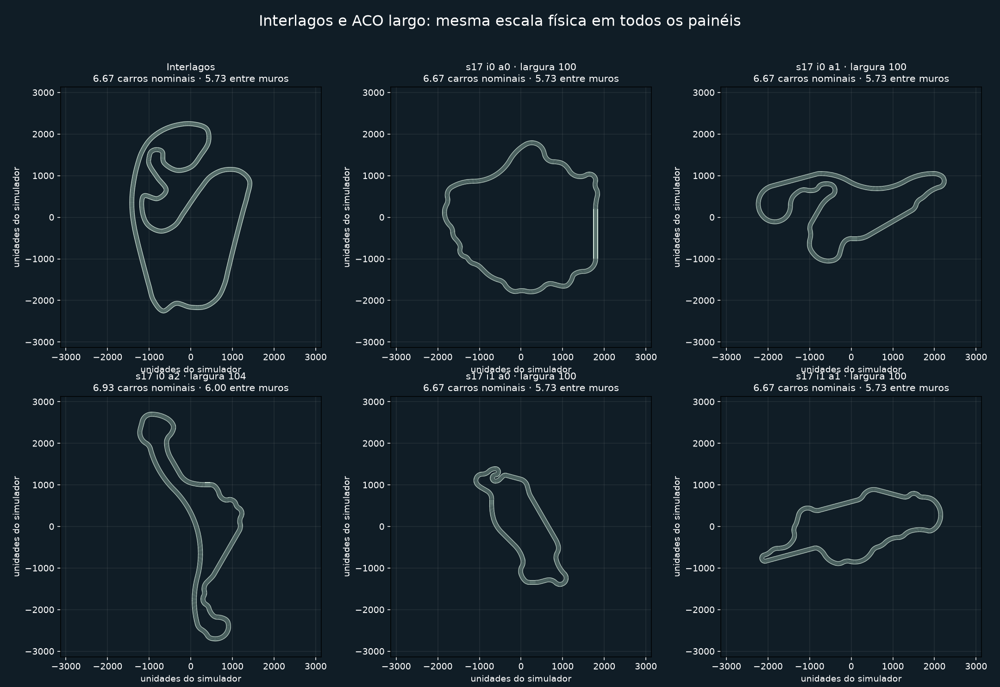
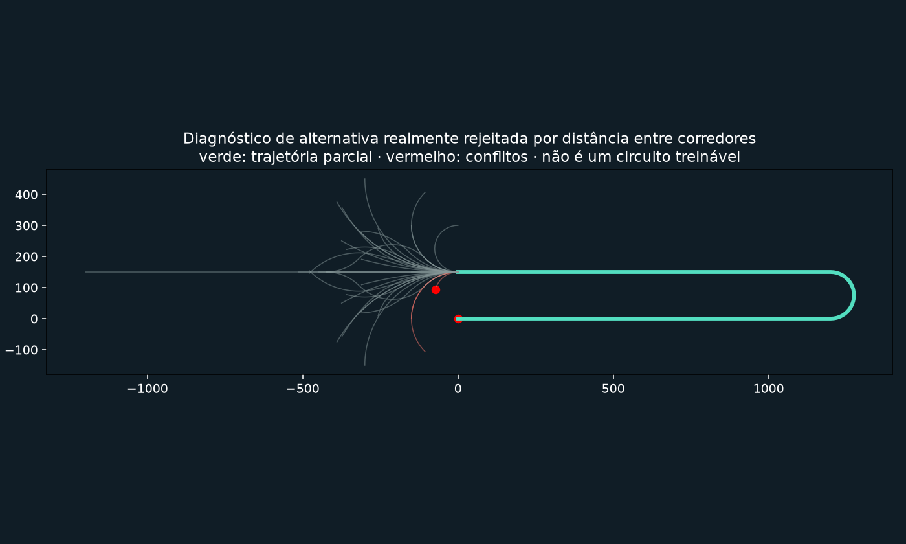

# Largura física e inspeção das candidatas ACO

**Interface atualizada:** a inspeção agora desenha na cena principal, com botões de melhor pista, geração e candidata. Veja [visualização principal](ACO_VISUALIZACAO_PRINCIPAL.md); as capturas deste documento registram a interface anterior.

O sequencial orgânico conserva suas fases, ações, equações de fechamento e heurísticas. A alteração de geometria é nos parâmetros: larguras **96/100/104**, raio base **75**, reserva de corredores calculada pela maior largura. As candidatas, inclusive recusadas, agora têm inspeção e exportação próprias.

## Largura: referência e medição



Interlagos tem largura nominal 100. Com `CAR_WIDTH = 15`, são 6,67 larguras de carro. Os muros existentes têm espessura 14 e são centrados nas bordas: numa seção reta, a faixa entre suas faces internas é aproximadamente **86**, ou **5,73 carros**. A largura nominal e a faixa livre física são grandezas diferentes. Isso também se aplica às pistas existentes.

| Circuito/configuração | Largura nominal | Carros nominais | Faixa entre muros em reta | Carros na faixa livre |
| --- | ---: | ---: | ---: | ---: |
| Interlagos | 100 | 6,67 | 86 | 5,73 |
| ACO anterior | 44 / 52 / 60 | 2,93 / 3,47 / 4,00 | 30 / 38 / 46 | 2,00 / 2,53 / 3,07 |
| ACO novo | 96 / 100 / 104 | 6,40 / 6,67 / 6,93 | 82 / 86 / 90 | 5,47 / 5,73 / 6,00 |

Não houve ajuste de zoom nem escala de carro. A definição exportada contém a largura real, `Track` calcula as bordas deslocando a linha central por metade dessa largura, o asfalto usa essas bordas e os colliders Avian usam os mesmos segmentos. A espessura dos muros agora vem de uma única constante compartilhada entre renderização e física.

Os testes medem distâncias entre bordas e usam consultas Avian. Em uma reta de largura 100, os raios encontram aproximadamente 86 unidades entre faces internas; cinco retângulos de carro 28 × 15, separados lateralmente por 16 unidades, não colidem. Aproximar o carro do muro produz colisão. O mesmo teste confere Interlagos.

Para a bateria inteira, os raios são lançados nas seções intermediárias dos segmentos, perpendicularmente à linha central. A medição evita usar exatamente a junção de dois colliders. As pequenas diferenças em curvas vêm da discretização dos arcos.

## Curvas largas e segurança geométrica



O hairpin padrão mantém mudança de direção de **180°**, com raio central **75**. Com largura 100, o raio da borda interna é 25. A largura máxima padrão, 104, exige raio de pelo menos 69 pela regra existente: `max(1/max_curvature, largura/2 + CAR_LENGTH/2 + 3)`. R75 oferece margem acima disso. Um hairpin R50 não recebeu largura 120.

Uma configuração incompatível é recusada com o raio mínimo necessário e a mensagem explícita de que a largura **não foi reduzida**. Configurações estreitas R50 continuam possíveis e os testes físicos anteriores de La Source continuam passando. As ações de hairpin, chicane e S permanecem disponíveis.

A construção reserva `max(widths) + minimum_border_gap + 5` para separação de corredores: **121 unidades** no padrão. As validações finais continuam verificando linha central, duas bordas e interseções entre bordas, curvatura, spawn e comprimento. O teste físico do hairpin largo completa a volta. Os testes de projeção verificam o ramo atual, inclusive no cenário de trechos paralelos próximos.

## Bateria fixa

Seeds **17 e 47**, três formigas × duas iterações por seed: **12 tentativas anteriores e 12 largas**, sem retries. A configuração anterior usa explicitamente 44/52/60 e R50; a larga usa 96/100/104 e R75. Todas usam o sequencial orgânico atual, até 26 decisões e o mesmo limite de comprimento. As figuras abaixo usam a mesma escala espacial nos painéis.



| Resultado | Anterior | Largo |
| --- | ---: | ---: |
| Geometrias válidas / tentativas | 12/12 | 12/12 |
| Voltas completas pelo piloto de referência | 12/12 | 12/12 |
| Aceitas pela seleção | 11 | 12 |
| Rejeitadas por diversidade | 1 | 0 |
| Largura nominal média | 52,67 | 100,33 |
| Faixa física média medida no Avian | 38,65 | 86,32 |
| Largura nominal / carro, média | 3,51 | 6,69 |
| Retangularidade média | 0,098 | 0,107 |
| Entropia de headings média | 0,931 | 0,921 |
| Complexidade geométrica média | 0,949 | 0,943 |

A taxa de geometria válida permaneceu em 100% nesta amostra. A organicidade ficou próxima da versão anterior; as pequenas diferenças acompanham o aumento dos raios e as restrições de comprimento. Essa bateria pequena não estima taxas universais para todas as configurações.

Entre as 12 pistas largas, 11 têm hairpins detectados, oito têm chicanes detectadas e todas têm S. O caso específico de hairpin R75 foi dirigido e completado na física real.

O [CSV por circuito](validation/aco_width_inspection/metrics.csv), os [resultados completos](validation/aco_width_inspection/results.json) e o [resumo](validation/aco_width_inspection/summary.json) incluem larguras, proporções, raios, hairpins/chicanes/S, conclusão física, aceitação e motivo. As definições, bordas e linhas centrais de todas as 24 candidatas estão nas quatro pastas de variante/seed.

## Tipos de rejeição

**Geometria inválida/incompleta:** o snapshot guarda decisões, parâmetros, definição bruta quando disponível, trajetória parcial, alternativas terminais e regiões diagnosticadas. Interseções da linha central, de cada borda ou entre bordas são localizadas usando a mesma amostragem geométrica de `Track`. Violações de curvatura destacam a região de maior curvatura. Conflitos de corredores registram os dois pontos e as distâncias. Restrições globais de orçamento são apresentadas como tais.

**Geometria válida rejeitada pela seleção:** permanece uma `GeneratedTrack` completa e validada, com motivo e avaliação disponíveis. Isso inclui duplicata, diversidade insuficiente, limite de vagas por score, falha/timeout da referência e erros/orçamento de avaliação. O fracasso da referência não muda a validade geométrica.

Casos adicionais, separados da contagem da bateria:

| Caso | Resultado e evidência |
| --- | --- |
| Referência com timeout real de 120 decisões | `ReferenceTimeout`; geometria válida preservada e exportada. Com limite normal, a mesma pista completou em **4.943 decisões**, sem colisão. [Comparação das avaliações](validation/aco_width_inspection/reference-retry.json). |
| Orçamento geométrico impossível, comprimento máximo 2 | `ClosureInfeasible`; nenhum circuito validado. Snapshot contém o estado inicial e todas as alternativas recusadas. [Diagnóstico](validation/aco_width_inspection/geometry-invalid/diagnostic.json). |
| Alternativa com corredores próximos | Diagnóstico controlado usando as expansões reais reta → hairpin → reta: distância **119**, mínimo **121**. A alternativa recusada e seus pontos são preservados; não é contabilizada como uma candidata final sorteada pelo ACO. [Diagnóstico](validation/aco_width_inspection/corridor-rejected/diagnostic.json). |
| Interseção explícita de linha central | Teste unitário com linha amostrada cruzada verifica localização dos segmentos e recusa de `Track`. |



Os testes de retenção também geram rejeições por vagas de seleção e verificam que motivos e decisões continuam disponíveis depois de expirar o detalhe.

## Como inspecionar

Abra ACO → **Candidatas**. A lista reúne todas as iterações da busca atual e oferece filtros **Todas**, **Aceitas**, **Rejeitadas**, **Geometria inválida** e **Válidas rejeitadas**, além de busca textual pelo motivo/código. Selecione uma linha para ver classificação, motivo, parâmetros, métricas, fitness e avaliação da referência. **Ver traçado e decisões** abre o desenho com o controle de decisões visíveis. **Comparar** fixa outra candidata para a tabela e o traçado azul sobreposto.

As válidas rejeitadas têm **Exportar pista válida selecionada** e **Testar selecionada com PPO**. O teste usa um checkpoint existente escolhido no seletor ou no painel do piloto. Nenhum treinamento é iniciado. O projeto não oferece direção manual de carro nesse visualizador; não foi criado um novo modo de condução nesta alteração.

As inválidas mostram o aviso de diagnóstico, segmentos/regiões em vermelho e somente **Exportar diagnóstico selecionado** habilitado. A exportação diagnóstica produz JSON, com `training_eligible: false`, sem criar uma definição de pista para o conjunto de treinamento. A API também bloqueia exportar uma inválida como pista, antes de criar o diretório.

Capturas reais Bevy/Vulkan: [válida rejeitada e exportação habilitada](validation/aco_width_inspection/ui/01-valid-rejected-list.png), [seu circuito](validation/aco_width_inspection/ui/02-valid-rejected-track.png), [conflito físico destacado](validation/aco_width_inspection/ui/03-invalid-corridor.png) e [filtro de inválidas com exportação/PPO bloqueados](validation/aco_width_inspection/ui/04-invalid-filter.png).

O [fluxo normal com pista larga](validation/aco_width_inspection/ui/05-wide-live-track.png) também foi executado pelo teste nativo, acionando Iniciar, pausa computacional, passo por iteração, retomada, persistência e exportação. [Log dos controles](validation/aco_width_inspection/logs/native-controls.log). Os artefatos da execução têm [manifesto SHA-256](validation/aco_width_inspection/manifest-sha256.json).

## Persistência, retenção e CLI

Os metadados de inspeção têm versão 1, separada da versão da geometria sequencial v2. Campos novos têm defaults para leitura das buscas anteriores. Os snapshots incluem identificação estável, classificação, motivo, diagnósticos e indicação de expiração. Arquivos e diretórios existentes não são sobrescritos.

As regras novas de compatibilidade largura/raio são identificadas por `width_geometry_version: 1`. Arquivos antigos sem esse campo mantêm versão 0 e suas regras de parâmetros para reprodução, inclusive quando uma primitiva individual era excluída por curvatura. A validação geométrica final não é removida.

Por padrão, são preservadas **128 candidatas detalhadas** e matrizes de feromônios de **16 iterações**. Os previews de alternativas das decisões antigas são removidos por padrão, mantendo pontos/decisões e diagnósticos terminais. Depois do limite, os detalhes geométricos expiram, mas ficam identificação, validade, escolhas/probabilidades, fitness e motivo. As melhores selecionadas são mantidas também no arquivo de seleção. Os limites globais de iterações/candidatas continuam valendo.

Exemplo de configuração RON, dentro de `AcoConfig`:

```ron
retention: (
    detailed_candidates: 128,
    pheromone_iterations: 16,
    keep_alternatives: false,
    export_rejected_valid: true,
    export_diagnostics: true,
),
```

As opções de exportação automática são desativadas por padrão. Com elas ativadas, a busca CLI exporta apenas os detalhes ainda retidos, em pastas por iteração/formiga, com manifesto de todas as candidatas. As opções podem ser configuradas na interface para a próxima busca.

**Salvar snapshot da inspeção** inclui também as candidatas já construídas e a trajetória atual de uma iteração ainda incompleta, mesmo antes da primeira iteração terminar. Essa parte fica em `in_progress`, somente para inspeção/replay/exportação. O arquivo não afirma conter um RNG intermediário resumível: para reconstruir, reinicie a busca; a pausa/retomada da tarefa viva continua funcionando normalmente.

Para exportar um arquivo existente pela CLI:

```powershell
cargo run -p neuroevolution-racing-app --no-default-features -- aco inspect caminho/search.ron --output nova-pasta --rejected-valid --diagnostics
```

Para reproduzir a bateria, use uma pasta de evidências nova ou mova a execução anterior; os testes recusam sobrescrita:

```powershell
cargo test -p neuroevolution-racing-app --no-default-features width_and_rejection_evidence_battery -- --ignored --nocapture
cargo test -p neuroevolution-racing-app --no-default-features inspection_rejection_cases_evidence -- --ignored --nocapture
python tools/render_aco_width_inspection.py docs/validation/aco_width_inspection
cargo test --workspace -- --test-threads=4
cargo test -p neuroevolution-racing-app native_rejected_candidate_inspection_and_capture -- --ignored --nocapture
```

Não houve reformulação do construtor, alteração da matemática PPO/GA/currículo, treinamento longo ou benchmark de hardware. Uma espera do teste de integração do worker foi ampliada para acomodar as pistas maiores; não altera o comportamento do currículo.

Validação final: **410 testes aprovados no workspace, zero falhas, dez testes opt-in ignorados na execução normal**. A bateria física, os casos adicionais de rejeição e as capturas nativas foram executados explicitamente e passaram. Os testes cobrem salvamento/carregamento, retenção e RNG, snapshot parcial, inspeção de detalhe expirado, exportação de válida rejeitada e bloqueio de inválida. A CLI sem recursos visuais compilou, exportou ambos os tipos corretamente e leu uma busca v2 real anterior aos ajustes. [Log da suíte](validation/aco_width_inspection/logs/workspace.log).
