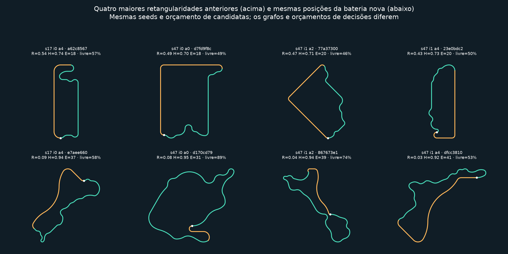

# ACO sequencial: exploração e organicidade

**Atualização posterior:** a [correção de largura física e inspeção de rejeições](ACO_LARGURA_INSPECAO.md) mantém este construtor orgânico e atualiza larguras/raios. As medições deste documento preservam a configuração estreita anterior.

A configuração nova mantém o gerador sequencial v2 e passa a usar `organic: true`, com até 26 decisões de movimento. A bateria fixa abaixo reduziu os retornos retangulares nas duas seeds, preservando validação geométrica, física, replay e controles da interface.



Acima estão os quatro maiores índices de retangularidade anteriores. Abaixo, as mesmas posições de seed/iteração/formiga na busca nova, sem escolher os melhores resultados posteriores. Verde representa construção livre/orientada, laranja representa fechamento, branco marca a partida. As imagens usam os pontos reais exportados, com proporções espaciais preservadas; não são desenhos ilustrativos.

## Construção

O orçamento padrão anterior tinha 18 decisões; o novo tem 26. A reserva nominal para retorno é de seis decisões. A fase livre ocupa as primeiras 13 decisões; a orientada, as decisões 13–19; depois aumenta a pressão de fechamento. A seleção continua probabilística por **τ^α η^β**, com q0, evaporação e reforço MMAS. Os limites das fases dependem do orçamento configurado.

Na fase livre, η de fechar começa em 0,0001. Na orientada, continua baixo, mas as expansões consideram o comprimento da continuação de retorno verificada. Isso ajuda a explorar sem acumular uma dívida de retorno enorme. O algoritmo também considera famílias de elementos, repetições, orientação, expansão espacial e sequências de retas.

A prontidão para fechar combina comprimento desejado (`max(min_length, 3 × raio_base × orçamento)`), dez eventos geométricos e três famílias de curvatura. São preferências graduais. Se apenas o fechamento continuar viável, ele é executado e a interface informa a causa. Uma pista não precisa conter todos os elementos disponíveis.

O grafo ganhou 16 ações, chegando a 36 alternativas: bends de 15°/30°, curvas longas de 60°, curvas compostas com raios distintos, kink seguido de curva oposta, deriva angular leve, S assimétrico e sequências de raios progressivos. As ações anteriores continuam presentes, incluindo reta de 800 unidades e hairpin R50. Não há ruído nos pontos nem spline arbitrária para unir pontas.

O retorno resolve duas equações de deslocamento com sequências assimétricas de arcos e direções em passos de 15°. Compara até quatro soluções viáveis pelo comprimento e pelo maior conector. Conectores maiores que 16 raios base usam uma composição em S de quatro arcos suaves, com o mesmo deslocamento e tangente de uma reta; os raios são calculados pelo comprimento do conector. Cada composição é amostrada e testada contra os corredores existentes. Essa composição conta como uma decisão e contém quatro subarcos, assim como S/chicanes livres já eram ações compostas.

Toda expansão disponibilizada mantém uma continuação de fechamento verificada. Essa continuação é guardada para evitar recalculá-la ao selecionar Fechar. Tangência, curvatura, largura, folga, ausência de interseções, spawn e validação final continuam obrigatórios. A física e os limites do carro permanecem os mesmos.

A qualidade orgânica ocupa 20% do score novo, combinando complexidade, retangularidade, entropia de headings e dominância da maior reta. Isso participa do reforço real dos feromônios. Pistas rápidas e alongadas continuam possíveis.

## Bateria fixa e resultados

Foram executadas **seeds 17 e 47**, seis formigas por iteração, duas iterações: **24 tentativas antes e 24 depois**, sem retries nem descarte de candidatas ruins. A versão anterior usou exatamente o grafo e o orçamento de 18 decisões anteriores; a nova, 26. Os demais parâmetros ACO e dimensões são os mesmos. Portanto, a comparação avalia a mudança completa, incluindo o orçamento maior, e não isola a contribuição de cada componente.

As 48 geometrias foram válidas e completaram a volta no piloto de referência em Avian2D. Em cada população, 23/24 foram aceitas por diversidade; uma foi rejeitada por similaridade. As imagens e médias incluem também essas duas candidatas rejeitadas. Nenhum treinamento PPO foi usado para obter os resultados.

| Métrica — média de todas as 24 candidatas | Antes | Depois |
| --- | ---: | ---: |
| Comprimento total, unidades do simulador | 6.410,94 | 7.773,46 |
| Decisões livres antes de Fechar | 13,08 | 20,75 |
| Comprimento já construído ao selecionar Fechar | 54,00% | 67,98% |
| Células físicas de 200 × 200 visitadas antes de Fechar | 21,42 | 32,46 |
| Células físicas visitadas no circuito inteiro | 37,54 | 47,00 |
| Maior reta | 1.596,58 | 616,34 |
| Maior reta / comprimento total | 24,49% | 8,03% |
| Fração do comprimento em retas | 53,38% | 16,23% |
| Entropia de headings, normalizada | 0,774 | 0,929 |
| Concentração em dois eixos ortogonais | 0,412 | 0,144 |
| Preenchimento da caixa orientada | 0,617 | 0,523 |
| Aspecto da caixa orientada | 1,603 | 1,987 |
| Retangularidade | 0,262 | 0,078 |
| Fração de curvas próximas de 90° | 37,77% | 14,60% |
| Variação angular acumulada, radianos | 21,14 | 28,84 |
| Eventos geométricos | 19,63 | 36,13 |
| Famílias geométricas | 3,17 | 3,54 |
| Compacidade, 4πA/L² | 0,510 | 0,412 |
| Complexidade global, normalizada | 0,843 | 0,953 |
| Células com escala normalizada pelo comprimento | 27,33 | 27,42 |
| Candidatas com retangularidade > 0,30 | 8/24 | 0/24 |
| Candidatas com maior reta > 25% da pista | 12/24 | 0/24 |

A redução média de retangularidade foi **70,3%**; a concentração em eixos caiu **65,0%**; os eventos aumentaram **84,1%**. A ocupação física antes do fechamento cresceu **51,6%**. A ocupação normalizada ficou praticamente estável: o passeio ocupa mais espaço físico, com crescimento de comprimento, mas essa métrica específica não indica maior eficiência de ocupação. O aspecto da caixa aumentou, compatível com circuitos alongados; ele isoladamente não mede retangularidade.

Na população nova, **14/24** ainda têm reta maior que 700 unidades, **22/24** têm hairpins detectados, **13/24** atingem raio próximo de 50, **20/24** têm chicanes detectadas e **24/24** têm S. O teste específico de reta + hairpin R50 também verifica frenagem antecipada e volta completa na física real.

### Todas as candidatas

- Seed 17: [antes](validation/aco_organic/before-17.png) e [depois](validation/aco_organic/after-17.png).
- Seed 47: [antes](validation/aco_organic/before-47.png) e [depois](validation/aco_organic/after-47.png).
- [Distribuições de headings e comprimentos de reta](validation/aco_organic/distributions.png).
- [CSV por candidata](validation/aco_organic/metrics.csv), [resumo numérico](validation/aco_organic/summary.json) e [registros da execução](validation/aco_organic/comparison.json).

## Definições e limites

As métricas usam a linha central e pesos por comprimento. Retas são trechos com |κ| < 0,0004; a distribuição registra trechos acima de 20 unidades, unindo a reta que cruza a emenda do circuito. Headings usam 24 bins com deposição linear. A entropia é normalizada por ln(24). A concentração em eixos é o módulo do quarto momento circular: vale perto de um quando predominam dois eixos ortogonais, incluindo circuitos rotacionados.

A caixa orientada é a menor entre 24 orientações entre 0° e 90°. Retangularidade é preenchimento da caixa × concentração em eixos. Uma circunferência não recebe uma penalidade de retângulo apenas por preencher sua caixa. Eventos contam mudanças persistentes por pelo menos 30 unidades entre reta e classes de curvatura/raio/sentido; famílias contam reta, curva suave, média e apertada. Complexidade combina eventos, excesso de rotação absoluta sobre 2π, entropia e dispersão dos eixos. A métrica de 90° usa agrupamentos de curvas por sentido, com tolerância de 0,16 radianos.

O limiar 0,30 serve para resumir a bateria, não é um veto universal nem uma definição estética. A prova principal inclui os painéis completos. Duas seeds e 24 candidatas novas demonstram melhora nessa bateria; não garantem toda configuração. Ainda há curvas de raio constante, transições de curvatura C1 e circuitos cujo retorno ocupa parte substancial do comprimento. As soluções não são clotóides nem circuitos homologados.

## Interface, replay e compatibilidade

Iniciar, Pausar, Continuar, Uma decisão, Uma iteração, replay, exportação e seletor clicável de PPO continuam disponíveis. O painel mostra fase, motivo, η de fechar, eventos/famílias e a mensagem **Escolheu passear mais; havia fechamento viável**. As probabilidades exibidas pertencem à distribuição real, inclusive quando apenas Fechar é viável.

Capturas do Bevy/Vulkan real: [exploração livre e pausa](validation/aco_organic/ui/01-partial-paused.png), [fechamento](validation/aco_organic/ui/02-closure-progress.png), [pista completa](validation/aco_organic/ui/02-complete-validated.png) e [feromônios](validation/aco_organic/ui/03-pheromones.png).

Configurações antigas que omitem `organic` continuam com o grafo anterior de 20 escolhas e o fechamento anterior. A configuração padrão criada pela interface ativa a melhoria. O replay CLI carregou uma busca v2 real salva pelo executável anterior aos ajustes, conservando suas pistas e hashes. As quatro buscas da comparação estão compactadas sem perda como `search.ron.zip` nas pastas de cada variante/seed; [manifesto SHA-256](validation/aco_organic/archives.json). Basta descompactar para usar replay/exportação. Os arquivos `.generated.ron`, `.ron` e `.json` de cada candidata também estão preservados.

## Reprodução

Use um diretório de evidências novo:

```powershell
$env:ACO_ORGANIC_EVIDENCE = 'target/aco-organic-review'
cargo test -p neuroevolution-racing-app --no-default-features organic_geometry_comparison_battery -- --ignored --nocapture
python tools/compare_aco_organic.py target/aco-organic-review
cargo test --workspace
cargo test -p neuroevolution-racing-app native_bevy_start_progress_pause_resume_and_capture -- --ignored --nocapture
```

O script verifica também os limiares comparativos de retangularidade, eixos, maior reta, entropia, exploração e eventos. Os testes unitários verificam invariância aproximada por rotação, círculo versus retângulo, tangência/raio dos conectores e pressão de fechamento por fase. O teste nativo acionou controles por ponteiro e confirmou pausa computacional, passo por iteração, retomada, feromônios, persistência e exportação. O teste do checkpoint por clique e a integração com PPO congelado também passaram.

Resultado final: **404 testes aprovados no workspace, zero falhas e seis ignorados na execução normal**. A bateria comparativa e o teste gráfico nativo foram executados explicitamente e passaram. A versão sem recursos visuais compilou e executou tanto a bateria quanto o replay da busca anterior. O teste de fluxo completo da interface precisou ampliar sua espera de 10 para 60 segundos para acomodar iterações maiores durante a execução concorrente dos testes; ele passou novamente e na suíte completa. [Logs da validação](validation/aco_organic/logs/workspace.log).
