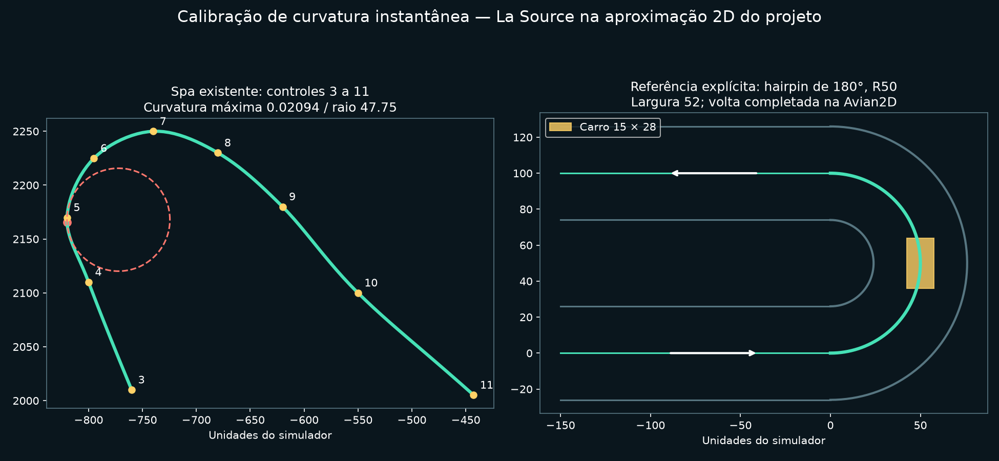
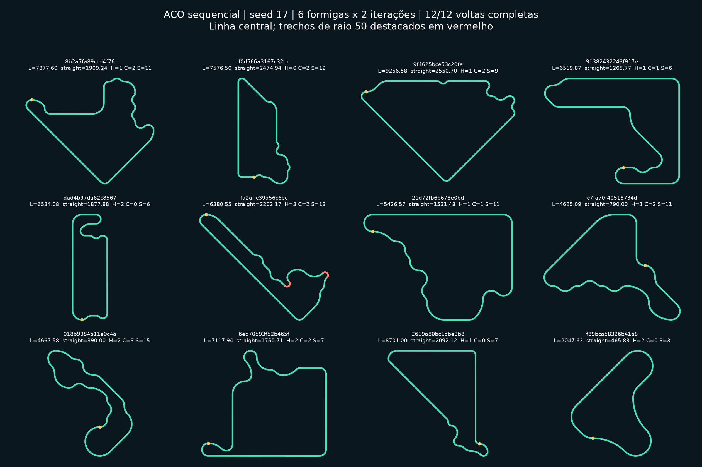
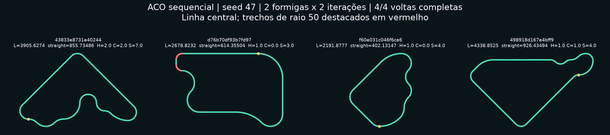

# ACO sequencial v2 — implementação e validação

**Atualização de organicidade:** veja [fases de exploração, comparativos e evidências novas](ACO_ORGANICO.md). As medições abaixo documentam a versão anterior, mantida para reprodução; a configuração atual ativa `organic: true` e 26 decisões.

Novas buscas abrem em **Sequencial v2**. Selecione ACO e clique em Iniciar. O seletor de checkpoints continua disponível por clique ao marcar **Avaliar com PPO congelado**. Não é necessário preparar buscas no terminal. **Radial legado** permanece disponível para comparação e reprodução de resultados anteriores.

## Representação e fechamento

O estado da formiga contém posição, orientação, caminho percorrido e orçamento restante. As alternativas incluem retas de 100/300/800 unidades; arcos de 45°, 90°, 135° e 180°; hairpins de raio 50; S e chicanes compostos; e curvas rápidas de raio 300. Os comprimentos e raios escalam com o raio base. Cada decisão de movimento altera efetivamente a posição e/ou orientação, sem centro radial, restrição de convexidade ou catálogo de circuitos prontos.

Antes de disponibilizar uma expansão, o motor procura uma continuação de fechamento viável. Um conjunto finito de planos de retas e arcos resolve as duas equações de deslocamento e a orientação final. Os eixos acompanham a orientação atual, inclusive diagonais. O plano deve respeitar comprimento, número de segmentos, raio mínimo, largura, folga entre corredores e ausência de colisões. O número de rotação de um circuito simples C1 deve ser +1 ou −1; essa condição elimina planos impossíveis antes dos testes espaciais. Ela é uma condição topológica de fechamento, diferente da curvatura instantânea.

A ação **Fechar** compromete a formiga com uma dessas continuações já verificadas. Suas primitivas são executadas e publicadas uma a uma, com probabilidade 1 durante essa fase. O fechamento não acrescenta uma spline arbitrária entre pontas aleatórias. Alternativas sem continuação dentro do grafo/orçamento recebem probabilidade zero e uma causa de rejeição. A candidata completa passa novamente pelos testes de centro, bordas, curvatura, comprimento e spawn.

As retas do fechamento podem ser maiores que as três opções livres: seus comprimentos são as soluções das equações de retorno, sempre dentro do limite total configurado.

As junções são C1, com tangentes contínuas entre retas e arcos analíticos. A linha central é amostrada a cada, no máximo, 10 unidades e compartilhada com a renderização, bordas, Avian2D, sensores e projeção de progresso. Uma fase ampla por caixas de segmentos acelera a validação densa, mantendo o predicado de interseção existente; um teste compara os resultados com a verificação de todos os pares.

## ACO e diversidade

O núcleo continua sendo o mesmo `SearchArchive` usado por interface, CLI e currículo PPO. A amostragem usa τ^αη^β, calculada de forma numericamente estável, com a mistura gulosa q0 registrada na distribuição marginal. A heurística usa contexto das escolhas anteriores, repetição de primitivas e fase de fechamento. Há evaporação, reforço limitado MMAS, reset por estagnação e RNGs separados e persistidos para construção e avaliação.

No sequencial, a solução aceita de maior score da iteração reforça feromônios; se nenhuma for aceita, usa-se o melhor global. O baseline radial conserva o reforço global anterior. Isso evita que a novidade inicial de uma única família determine sozinha todo o reforço posterior. A matriz representa posição de decisão × alternativa; a largura ocupa a última linha reservada, mesmo quando o circuito fecha antes do limite.

A diversidade usa comprimento, maior reta, fração em retas, quantidade de curvas, hairpins, chicanes, S e compactação, combinados com uma assinatura espacial de 16 pontos por distância de arco. A comparação considera reflexões, rotações de 90° e deslocamentos cíclicos. Espelhar uma pista não produz novidade artificial no teste de regressão. Pistas muito similares são rejeitadas pelo limite configurado; o arquivo de descritores é limitado a 256 entradas. Essas métricas caracterizam a população e orientam a novidade, sem exigir todos os elementos de cada pista.

O fitness mantém componentes separados. A novidade é medida no instante da construção; “melhor global” significa o maior score registrado, incluindo esse componente contextual, e não uma garantia de dificuldade intrínseca ou de ótimo global.

## Calibração por La Source

Fonte: [Spa existente](../assets/tracks/spa.ron), com `start_index: 0`. A aproximação identifica explicitamente a primeira curva como La Source. Foram examinadas as amostras entre os controles 3 e 11, abrangendo aproximação, ápice e saída. A maior curvatura aparece perto da amostra 59, imediatamente antes do controle `(-820, 2170)`.

Para três amostras consecutivas A, B e C, foi calculada a curvatura da circunferência local:

`κ = 2 × |(B−A) × (C−B)| / (|B−A| × |C−B| × |C−A|)`

O resultado é aproximadamente **κ = 0,02094**, ou **R mínimo = 47,75 unidades do simulador**. Isso não é a mudança total de direção da curva. A amplitude de um hairpin pode ser 180° com diferentes raios e, portanto, diferentes curvaturas.



O limite novo é 0,02094; a primitiva mais apertada usa raio **50**, aproximadamente 4,7% maior que o raio mínimo medido, com margem para discretização. As outras curvas usam raios maiores: 100, 150, 200 e 300 no padrão. As larguras padrão são 44/52/60, com o carro original de 15 × 28. A construção reserva folga para a maior largura disponível; os limites de curvatura e folga também são aplicados às primitivas do fechamento.

Spa é uma aproximação 2D: sua largura 96 chega a ser maior que duas vezes o raio instantâneo mais apertado. Portanto, não se deve interpretar seus controles como uma medição homologada de La Source nem aplicar essa largura indiscriminadamente a um arco circular de raio 50. A referência explícita desta implementação é um hairpin circular R50, na mesma escala física, com largura válida. A física e os limites veiculares não foram alterados.

## Controlador e progresso

A referência usa pure pursuit com lookahead menor nas curvas fechadas. Ela mede curvatura instantânea em estações à frente e propaga um envelope de velocidade pela distância de frenagem, usando os limites físicos existentes. A projeção da referência acompanha a vizinhança topológica atual, como o progresso e os sensores antecipatórios do RL.

No teste explícito com reta e hairpin R50, a referência atingiu aproximadamente **159,99** na reta, reduziu para um pico de **74,60** na região apertada e completou a volta na Avian2D. O teste não afrouxa geometria nem colisões.

Uma segunda configuração, construída pelas expansões reais do gerador, contém duas retas paralelas separadas por 100 unidades. Foram verificadas **258 projeções**, incluindo deslocamentos laterais próximos das bordas: nenhuma saltou para o trecho futuro. Nas voltas da bateria, também se verifica que a distância física percorrida não permite completar a pista por um salto de projeção.

Uma falha da referência continua significando dirigibilidade não comprovada. No modo sem piloto, a busca avalia geometria e diversidade; a validação física abaixo foi executada separadamente. Com PPO congelado, orçamento e timeout do checkpoint continuam limitando os episódios. Para pistas longas, configure um orçamento de avaliação suficiente; um timeout não é prova de impossibilidade física.

## Pistas produzidas

Busca real: **seed 17, seis formigas, duas iterações, limite de 12 candidatas**, sem treinamento PPO. A referência foi executada em cada candidata geométrica, com seed 55 e limite de 10.800 ticks.

**12 geometrias distintas, 12 aceitas por diversidade e 12 voltas completas pela referência.** O arquivo selecionado mantém as oito melhores conforme seu limite; os artefatos abaixo preservam as 12 candidatas para inspeção.



O painel mostra linhas centrais reais. Trechos próximos de R50 estão em vermelho; o ponto amarelo marca o início. Os [arquivos exportados](validation/aco_sequential/manifest.json) incluem definições Training, proveniência v2 e hashes. [CSV completo](validation/aco_sequential/metrics.csv).

| Exemplo | Identificador | Comprimento | Maior reta | Raio mínimo | Hairpins / chicanes / S |
| --- | --- | ---: | ---: | ---: | ---: |
| Reta longa | `9f4625bce53c20fe` | 9.256,58 | 2.550,70 | 99,93 | 1 / 2 / 9 |
| Hairpins R50 e combinação de elementos | `fa2affc39a56c6ec` | 6.380,55 | 2.202,17 | 50,00 | 3 / 2 / 13 |
| Chicanes e sequência técnica | `018b9984a11e0c4a` | 4.667,58 | 390,00 | 99,96 | 2 / 3 / 15 |
| S e curvas suaves/rápidas | `f0d566a3167c32dc` | 7.576,50 | 2.474,94 | 99,94 | 0 / 2 / 12 |
| Circuito compacto | `f89bca58326b41a8` | 2.047,63 | 465,83 | 99,97 | 2 / 0 / 3 |
| Outra organização espacial | `91382432243f917e` | 6.519,87 | 1.265,77 | 99,97 | 1 / 1 / 6 |

Na população, comprimentos variam de **2.047,63 a 9.256,58**, fração em retas de **17,77% a 71,36%**, curvas de **7 a 18** e compactação de **0,2758 a 0,6723**. A distância entre descritores varia de **0,1593 a 0,5132**, média **0,3235**; o limiar de novidade era 0,15. Essa escala é uma dissimilaridade geométrica, não uma probabilidade.

As primeiras imagens de desenvolvimento revelaram um viés de retornos retangulares. Isso motivou a inclusão de orientações diagonais, curvas de 45°/135° e fechamento no referencial atual. As pistas apresentadas são da implementação posterior a essa investigação.

## Interface e PPO real

O teste nativo Bevy/Vulkan acionou Iniciar por eventos de ponteiro no egui, verificou pausa computacional, retomada, avanço até a iteração e mudança dos feromônios. As capturas vêm do renderizador real:

- [Construção e alternativas com probabilidades](validation/aco_sequential/01-partial-paused.png)
- [Fechamento em andamento](validation/aco_sequential/02-closure-progress.png)
- [Circuito completo e validado](validation/aco_sequential/02-complete-validated.png)
- [Feromônios após as iterações](validation/aco_sequential/03-pheromones.png)

Também foi executada uma busca de uma candidata contra o checkpoint **treinado de 4.000 rollouts** existente, congelado em CPU: houve avaliação real de referência e PPO, uma candidata selecionada, e o SHA-256 do checkpoint permaneceu igual. [Resultados e identificação do checkpoint](validation/aco_sequential/frozen_evaluation.json). Isso comprova integração, sem afirmar que a política já domina as pistas novas. O teste nativo do seletor também carregou esse checkpoint por clique.

Nesse teste, a referência completou a volta em **1.986 decisões**. O PPO executou **191 decisões**, chegou a **11,48%** e terminou por colisão; o total debitado foi **2.177**. Portanto, a política antiga foi carregada e avaliada corretamente, mas não resolveu essa pista nova. Não houve treinamento adicional desse checkpoint.

Uma segunda busca fixa, **seed 47, duas formigas × duas iterações**, também foi executada contra esse checkpoint: **quatro novas candidatas, quatro conclusões da referência e 7.685 decisões totais de avaliação**. Os episódios PPO são registrados separadamente, e o checkpoint continuou byte a byte igual. [Resultados completos da segunda seed](validation/aco_sequential/frozen_seed47.json). Assim, a validação física compreende as 12 pistas da figura na seed 17 e mais quatro candidatas desta busca na seed 47.



São **16 geometrias distintas e 16 conclusões pela referência** nas duas seeds. O PPO antigo não completou as quatro pistas da segunda busca; seus progressos foram 11,48%, 26,01%, 21,00% e 34,21%, todos terminando por colisão. A referência e a política PPO têm resultados separados, como exige o diagnóstico de dirigibilidade.

## Compatibilidade e verificações

- **401 testes aprovados no workspace**, cinco ignorados pela suíte normal. Os dois testes nativos pertinentes foram executados explicitamente e passaram.
- **217 testes aprovados sem recursos visuais**, três ignorados; a compilação final sem recursos visuais também foi conferida.
- Busca CLI sequencial com seed 47, duas formigas × duas iterações: quatro candidatas selecionadas, replay e exportação concluídos.
- Replay de uma busca v1 real anterior à reformulação: concluído, preservando os resultados registrados.
- Teste de persistência v2 reproduz decisões e feromônios depois de salvar/retomar RNG; versões incompatíveis são rejeitadas.
- Integração de currículo PPO treina somente três rollouts de duas transições na bateria, verifica Adam, consumo de pistas geradas e retomada. Nenhum treinamento longo ou matriz de experimentos foi iniciado.
- GA, observações 25/31, projeção, colisões, checkpoint neural e backpropagation continuam cobertos pelos testes existentes.

Arquivos v1 continuam interpretados como geradores radiais/Catmull-Rom. V2 usa `shape: Sequential`, snapshots incrementais próprios e proveniência v2. Exportações usam `sampled_centerline: true`; assets antigos omitem esse campo e mantêm exatamente sua interpolação original. A biblioteca continua recusando registrar pistas geradas como Validation. Spa foi usada somente como referência geométrica de calibração; sua avaliação não entra no fitness das candidatas.

Para reproduzir com orçamento pequeno:

```powershell
cargo test --workspace
cargo test -p neuroevolution-racing-app --no-default-features
cargo test -p neuroevolution-racing-app sequential::validation -- --nocapture
cargo test -p neuroevolution-racing-app native_bevy_start_progress_pause_resume_and_capture -- --ignored --nocapture
target/debug/neuroevolution-racing.exe aco search --config configs/aco/sequential_smoke.ron --seed 47 --output NOVO_DIRETORIO
python tools/render_aco_geometry.py DIRETORIO_DE_EVIDENCIAS_IMPRESSO_PELO_TESTE
```

Logs locais: [workspace](../target/sequential-final-tests.log), [headless](../target/sequential-headless-tests.log), [interface nativa](../target/sequential-native.log), [currículo e retomada](../target/sequential-curriculum.log). O arquivo integral da busca da bateria permanece em `target/sequential-aco-evidence/1794433067427965000/search.ron`.

## Limitações

- A paleta tem raios e amplitudes discretos. As junções são C1, sem transições de curvatura C2/clotoides. Não é uma ferramenta de projeto ou homologação de circuitos reais.
- O fechamento verifica uma família finita de planos e escolhe o primeiro viável. Pode rejeitar uma expansão para a qual existiria outro fechamento fora dessa família; isso é inviabilidade no grafo/orçamento, não impossibilidade geométrica universal.
- A assinatura de forma usa 16 amostras e transformações discretas. Ajuda a evitar cópias e famílias próximas, mas não resolve toda equivalência geométrica.
- Uma volta determinística da referência por pista demonstra capacidade nas condições testadas. Não certifica todas as velocidades, seeds, configurações ou políticas PPO; nenhuma convergência de PPO nas pistas novas é alegada.
