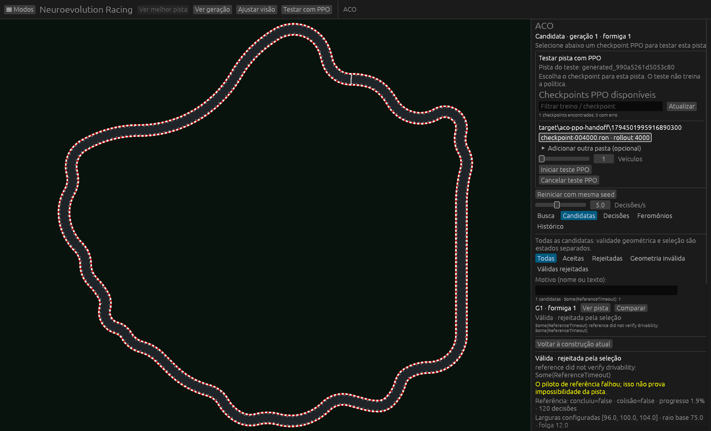
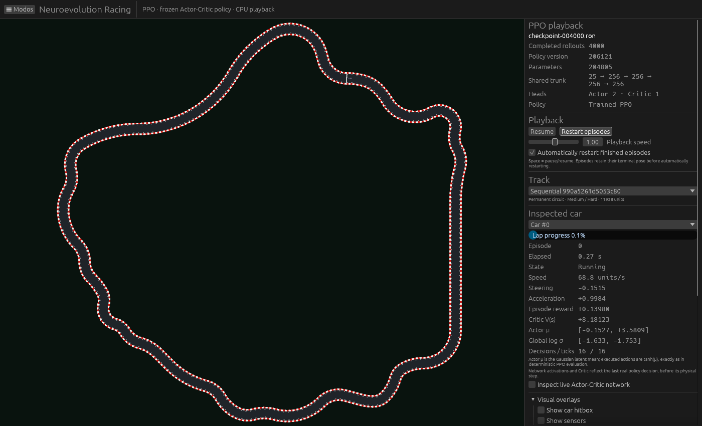

# Testar uma candidata ACO com checkpoint PPO

O comando **Testar com PPO**, na barra superior do ACO, usa a pista que está selecionada na visualização. Os comandos da aba Busca e da inspeção de candidatas usam o mesmo fluxo. Se ainda não houver checkpoint escolhido, o seletor aparece no próprio painel ACO, com o identificador da pista do teste. Selecionar o checkpoint ou clicar em **Iniciar teste PPO** abre o visualizador nessa pista.



A pista do teste é guardada no momento do clique. Assim, a escolha posterior do checkpoint continua vinculada à candidata original, mesmo se outra formiga avançar na busca. Pistas geometricamente válidas rejeitadas pela seleção também podem ser testadas. As inválidas continuam bloqueadas.

O novo teste inicia com reprodução ativa, velocidade normal e o primeiro carro selecionado. Não herda pausa, reinício ou trocas de checkpoint/pista pendentes do visualizador anterior. Voltar a um visualizador existente continua preservando seu estado: essa limpeza acontece ao abrir um **novo** teste. A busca ACO é pausada quando o PPO assume a visualização.

Erros de pista ou checkpoint aparecem no painel atual. Se a pista não puder ser registrada, o carregamento para antes de abrir a política, sem usar silenciosamente a pista anterior. Se o checkpoint falhar, a pista física anterior não é substituída por uma seleção parcialmente carregada.

## Reprodução e validação

O teste de regressão reproduziu a falha com o visualizador anterior pausado e pedidos antigos de troca de pista/checkpoint enfileirados. Antes da correção, o novo teste permanecia pausado. Depois, executou inferências e ticks físicos na pista solicitada, mantendo o checkpoint intacto.

O teste nativo acionou por ponteiro o botão do ACO e a linha do checkpoint no seletor. Usou a candidata `generated_990a5261d5053c80`, de largura **100**, geometricamente válida e anteriormente rejeitada por timeout da referência, e uma cópia byte a byte do checkpoint treinado existente de **4.000 rollouts**.



Foram verificados a troca para o modo PPO, o identificador e a definição completos da pista, a política carregada, a remoção das prévias ACO e movimento físico real do carro. A amostra registrou **16 decisões/ticks físicos**, velocidade **68,75** e reprodução ativa. A captura foi pausada pelo teste depois desse avanço, para inspeção estável. Isso demonstra o funcionamento do teste; não afirma que essa política completa a volta no circuito novo.

Os arquivos do checkpoint original e da cópia permaneceram byte a byte iguais. Não houve treinamento nem alteração da matemática do PPO, da física ou da geração ACO. [Telemetria registrada](validation/aco_ppo_playback/playback.json) e [log nativo](validation/aco_ppo_playback/native.log).

Validação final: **415 testes aprovados no workspace, zero falhas, 12 opt-in ignorados na execução normal**. O teste nativo acima foi executado explicitamente e passou. O executável visual foi recompilado. [Log da suíte](validation/aco_ppo_playback/workspace.log).

```powershell
cargo test -p neuroevolution-racing-app new_track_preview_clears_old_pause_and_queued_requests_and_executes_policy -- --nocapture
cargo test -p neuroevolution-racing-app native_selected_aco_track_runs_with_checkpoint_despite_previous_pause -- --ignored --nocapture
cargo test --workspace -- --test-threads=4
```
