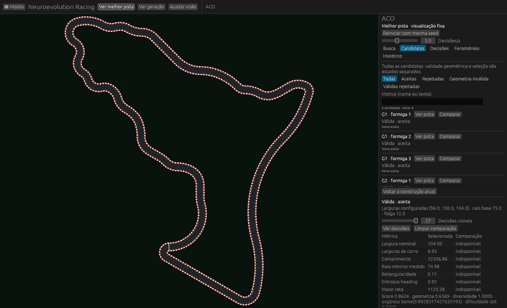
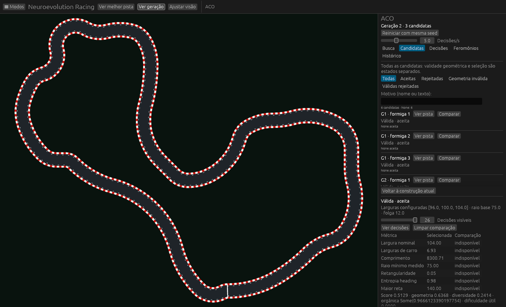
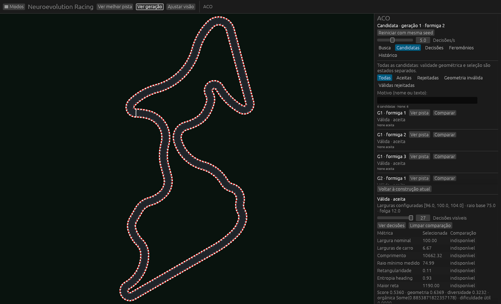

# ACO na visualização principal

A construção, a geração e as pistas selecionadas agora aparecem na **cena principal do Bevy**, usando a câmera e os mesmos meshes de asfalto/bordas do visualizador PPO. A janela flutuante de construção e a janela de câmera do modo ACO foram removidas. Configuração, candidatas, decisões, feromônios e histórico ficam nas abas do painel integrado.



Os comandos ficam na barra superior do próprio ACO:

- **Ver melhor pista:** fixa a melhor candidata disponível no instante do clique. A construção pode continuar em segundo plano sem substituir a pista escolhida. Clicar novamente atualiza a escolha.
- **Ver geração:** volta à geração atual e acompanha somente a pista/formiga em destaque. As demais candidatas ficam ocultas por padrão; marque **Mostrar outras pistas da geração**, na aba Busca, para sobrepô-las explicitamente. O seletor **Ver geração** permite consultar gerações anteriores.
- **Ajustar visão:** enquadra novamente a cena. Zoom pela roda, deslocamento com botão direito/meio, rotação com Q/E e tela cheia com F11 continuam disponíveis.
- **Testar com PPO:** vincula a candidata selecionada a um checkpoint e abre o teste na mesma pista. [Fluxo e validação](ACO_TESTE_PPO.md).



Na aba **Candidatas**, cada linha tem **Ver pista**, que desenha essa candidata diretamente na cena principal. Os filtros e a comparação permanecem disponíveis. **Ver decisões** abre a aba de decisões/probabilidades da candidata selecionada. As métricas, decisões e geometria usam a mesma seleção; uma nova mensagem da busca não troca silenciosamente essa seleção.



O problema anterior vinha de dois caminhos de visualização: os botões alteravam uma miniatura em uma janela separada, enquanto a cena principal ficava oculta no modo ACO. A escolha da melhor pista também alterava apenas a definição exibida e podia ser substituída por eventos seguintes. Agora há modos explícitos de geração, melhor pista e candidata, ligados ao renderizador principal.

Prévia geométrica não altera a pista física instalada para GA/PPO. As entidades de apresentação ACO são próprias e seus assets são removidos ao trocar a seleção ou sair do modo. Pistas válidas usam o asfalto e bordas reais. Construções parciais e diagnósticos inválidos são desenhados como linhas, alternativas e marcações vermelhas, sem asfalto de circuito validado nem registro de treinamento. O algoritmo ACO, as larguras, a física e a matemática PPO/GA permanecem os mesmos nesta mudança.

## Validação

O teste nativo Bevy/Vulkan acionou os botões por eventos reais de ponteiro: melhor pista → candidata da lista → geração. Conferiu o identificador da pista que efetivamente alimenta o renderizador, a criação de entidades visíveis, o enquadramento dos limites na câmera principal e a limpeza das prévias ao sair do ACO. A pista da simulação permaneceu inalterada. [Log dos cliques nativos](validation/aco_main_viewport/native-clicks.log).

O fluxo nativo de Iniciar, pausa computacional, passo por iteração, retomada, persistência e exportação também passou com a cena principal. [Log da busca ao vivo](validation/aco_main_viewport/native-live-controls.log). Os testes de seleção também publicam novos eventos de formiga/geometria durante a visualização fixa e verificam que eles não substituem a melhor pista escolhida. Um teste separado impede que uma geometria inválida produza uma definição de asfalto validado.

Resultado final: **412 testes aprovados no workspace, zero falhas, 11 testes opt-in ignorados na suíte normal**. Os dois testes nativos pertinentes foram executados explicitamente e passaram. A compilação sem recursos visuais também foi verificada. [Suíte completa](validation/aco_main_viewport/workspace.log).

Reprodução:

```powershell
cargo test --workspace -- --test-threads=4
cargo test -p neuroevolution-racing-app native_main_viewport_best_candidate_generation_buttons -- --ignored --nocapture
cargo test -p neuroevolution-racing-app native_bevy_start_progress_pause_resume_and_capture -- --ignored --nocapture
```

O teste nativo dos botões usa a busca sequencial orgânica fixa da seed 47 já preservada em `docs/validation/aco_width_inspection/wide-47/search.ron`. As capturas acima são do renderizador real, sem ilustrações ou reconstrução da interface.
